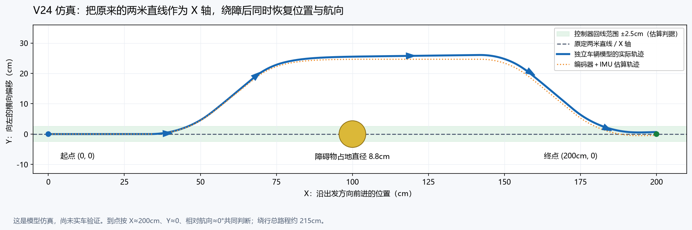

# V24：三路 TOF 选侧与坐标回线（已上车实测确认版）

本版为最终提交版本。参赛团队已确认两米直行、左右选侧绕障、返回原路线和终点停车上车测试通过；确认记录日期为 2026-10-30。工程：`drive_vision_tof_v24.gprj`，顶层 `ackermann_auto_top`，GAO 版本 `0x2401`。

## 本次确认的硬件参数

- 小车宽 200mm、长 270mm；轮径参数为 65mm，编码器为 1560 计数/轮转。
- 左前/正前/右前 TOF，相对正前为约 +45°/0°/-45°。
- 障碍物竖放，地面占地约 88×88mm，高约 215mm。TOF 光束高度应能照到物体，三束射线仍可能漏检细小物体。
- 舵机 F13；中位 1400us，向左最大 1039us，向右最大 1850us。左右极限脉宽保留当前值，控制器在两端之间连续调节。
- 引脚分配见 src/ov5640_ddr3_hdmi.cst；IMU 使用单一 I2C 主机，采集结果供显示与导航共享。

## 坐标计算

以两后轮轴线中点为位置参考。按 S1 被接受时记为起点 `(0,0)`，同时记录当时 IMU 航向。

原来打算走的两米直线就是 X 轴，终点 `(2000,0)`，向左为 Y 正方向。航向角 theta 是相对出发方向的夹角，向左转为正。

每个编码器更新窗口：

```
ds = (左轮距离 + 右轮距离) / 2
dx = ds * cos(theta)
dy = ds * sin(theta)
x = x + dx
y = y + dy
```

比如向左偏 30°走 100mm，X 增加约 86.6mm，Y 增加约 50mm；之后向右斜行，Y 会逐渐减少。单纯让航向回到 0°时，Y 并不会自动变成 0。

这里没有通过加速度两次积分算位移；距离来源是轮编码器，方向来源是 IMU。左右编码器不同拍到达时，每个轮子的增量按半权重分别累计。

坐标为有符号 Q8 毫米：GAO 的 `dbg_x_q8/256`、`dbg_y_q8/256` 是毫米。航向为 Q16 度：`dbg_heading_q16/65536` 是度。



图中终点按 X=200cm 计算，中点放障碍时模型实际绕行总路程约 215cm。它是仿真图，不是实车测量结果。

## 行驶与绕障

1. 上电保持小车静止，等待 IMU 静止标定以及三路 TOF 有效。没有按下并接受 S1，不输出舵机脉冲或驱动电机。
2. S1 开始任务，记录坐标原点、原始航向，舵机以 1400us 回正准备 1 秒。
3. 沿 Y=0 行驶，并根据横向偏移与航向误差轻微转向修正；目标是 X=2000mm。
4. TOF 任一路有效距离 <=400mm，连续 3 组新测量确认后决定绕行侧。左侧不足选右侧，右侧不足选左侧；两侧都有空间时优先更宽的一边，差距 <=100mm 时优先左。侧向可用空间初值为 500mm。两侧不足则停车报故障 2。
5. 方向锁定后，目标横向位置为 `±248mm`（100mm 半车宽 +88mm 障碍宽度上界 +60mm 余量）。控制器先向外打舵，接近旁行线时反向转舵，逐渐恢复原航向。
6. 沿旁行线通过障碍，直到 X 超过预计障碍物末端和车身余量，并连续确认正前方有空间。45° TOF 的前向投影用于估算障碍位置。不能只因某一路 TOF 已经看不到物体就立刻返回。
7. 把目标线改回 Y=0。根据剩余横向距离生成返回航向，接近原线时提前反向转向，以同时减小 Y 和航向误差。
8. 估算 Y 在 ±25mm 内且航向在 ±3°内，回到正常直行；到估算 X>=2000mm 且已完成回线、当前没有近障碍时停车完成。若两米处仍未完成绕行/回线，停车报故障 13，不继续冲过终点或误报成功。

目标航向与横向误差成比例，最大相对航向限制为 40°；舵机以航向误差反馈调节，最大脉宽限制仍是 1039/1850us。因此不是左右各固定走 40cm，也不是固定时间转回。

遇到多个先后出现的障碍时会重新判断选侧，但本版确认的测试范围是单个静止障碍。三路离散 TOF 没有建立完整障碍地图，也无法证明整个绕行区域无人、无其他障碍。

## 按键、指示灯和停车条件

- S0：全局复位；有故障后先排除原因，再 S0 复位。
- S1：开始；按住上电不会自动启动，需松开后重新按下。数据未就绪时按下不会排队自动启动。
- S3：停止当前任务；S2 仍切换视频源，S4 保留 IMU 会话/重标定功能。行驶中重标定会使 IMU 无效并停止任务。
- D0：电机前进命令；D1：故障；D2：绕障期间从左侧绕；D3：绕障中；D4：任务完成；D5：可按 S1；D6：TOF/IMU 未就绪；D7：心跳。灯显示命令/状态，不是舵机位置反馈。

本版导航依赖三路 TOF 和 IMU，持续检查数据有效性：坏帧、无效测距、TOF 超时 300ms、IMU 超时 250ms 或失去标定会停止，不把无效距离当成空地。任一路距离 <=100mm 时也会停止。

停机方式沿用关闭电机输出，没有新增主动刹车。实际有滑行距离，估算到点与实际停车点会有差异。

## 最常改的参数

主要在 `rtl/drive/ackermann_auto_top.v` 开头：

| 参数 | 初值 | 含义 |
|---|---:|---|
| SERVO_CENTER_US | 1400 | 中位脉宽 |
| SERVO_LEFT_US / SERVO_RIGHT_US | 1039 / 1850 | 左/右最大打角脉宽 |
| GOAL_MM | 2000 | 沿原始 X 方向的终点 |
| YAW_SIGN | 1 | IMU 航向方向：向左转时应增加；若实际相反改为 -1 |
| WHEEL_UM | 65000 | 实测轮径，单位微米；错误会直接影响米数和横向估算 |
| OBSTACLE_WIDTH_MM / OBSTACLE_LENGTH_MM | 88 / 88 | 障碍物在地面上占地尺寸上界，高度不填这里 |
| CLEARANCE_MM | 60 | 绕行额外余量 |
| SENSOR_FORWARD_MM | 270 | 后轮轴线中点到 TOF 安装位置的前向距离上界；因未提供安装尺寸，暂用整车长作保守上界 |
| AVOID_TRIGGER_MM | 400 | 避障触发距离，不等于保证任何速度/半径都能绕开的最短距离 |
| AVOID_RPM / MAX_RPM | 20 / 80 | 绕行/正常直行转速；近障碍或距终点 200mm 时降为 20RPM |
| LOOK_GAIN_Q8 | 128 | 横向每误差 1mm，期望航向改变约 0.5°，最大仍限 40° |
| HEADING_KP_US | 64 | 每度航向误差调整 64us，实际脉宽仍限 1039～1850us |

`rtl/drive/nav_controller.v` 中还有：`SIDE_CLEAR_MM=500`、`MAX_HEADING_DEG=40`、`Y_TOL_MM=25`、`HEADING_TOL_DEG=3`。修正力度会影响回线所需路程，当前参数对应本次实测确认固件；更换底盘、连杆或安装位置后应重新校准。

### 硬件变更后的校准

先在不启动电机时看 IMU：车头手动向左转，YAW 应增大（注意 ±180°回绕）。如果反向，修改 `YAW_SIGN=-1` 后重新编译。IMU 应水平固定在车体上，当前 yaw 算法假定车体接近水平。

再用地面两米标线检查轮径/编码器比例、中位 1400 是否真正直行。回线估算本身不能测出轮胎侧滑或地面标线的真实位置；2.5cm/3°是控制器判据，不是实车精度保证。当前 IMU yaw 是去偏后的陀螺仪积分，没有绝对位置修正，会随时间漂移。

测量 TOF 到后轮轴线的距离后可缩小 `SENSOR_FORWARD_MM` 的保守上界，让返回更早；不要把 21.5cm 高度填成障碍长度。障碍太靠近两米终点时可能没有足够路程完成绕行和回线，这时会以故障 13 停车。

## 故障码

| 码 | 原因 |
|---:|---|
| 1 | 某路 TOF 无效或超时 |
| 2 | 两侧空间不足，或任一路距离 <=100mm |
| 3 | 电机运行但连续约 3 秒没有编码器计数 |
| 4 | 编码器/转速方向异常 |
| 5 | 编码器更新超过 300ms 未到 |
| 6 | 当前阶段超过 30 秒 |
| 7 | 位姿累计收到异常大计数或处理重叠 |
| 8 | IMU 无效、未标定、恢复中或更新超时 |
| 9 | 相对航向超过 ±75°，可能方向设置有误 |
| 13 | 到达 X=2000mm 仍未完成回线或存在近障碍 |
| 14 | 横向超出预定旁行线外侧 200mm |

GAO 重点看 `dbg_phase`、`dbg_code`、`dbg_x_q8`、`dbg_y_q8`、`dbg_heading_q16`、`dbg_desired_heading_q16`、`dbg_pass_x_mm`、`dbg_servo_us` 和三路 TOF。阶段：0 空闲、1 准备、2 原路线直行、3 横移绕开、4 旁行通过、5 返回原线、10 完成、11 故障、12 手动停止。

## 构建、仿真与验证范围

`build.cmd` 运行完整 Gowin 构建，持久设置 CPU/SSPI 复用为 GPIO，并选择正确顶层。烧录新构建的 `impl/pnr/ao_0.fs`；预编译交付文件以及 SHA256 见 `reports/交付验证.md`。

`tests/run_tests.ps1` 运行 Icarus 回归。`reports/navigation_trace.csv` 保存独立车辆模型与编码器/IMU 估算轨迹。模型包含不同左右脉宽范围和不同的左右转弯半径（最大前轮角约 28.88°/36°）、50ms 舵机响应、20ms 指令保持、轮计数量化、45°射线测距，以及 20×27cm 车身和直径 8.8cm 障碍物的碰撞检查；模型轴距取 180mm，实际轴距和连杆关系未测量，因此模型通过不能替代实车调参。

参赛团队已确认上述功能上车测试通过。实车功能确认与静态时序分别记录；请以 `reports/交付验证.md` 中本次构建的实际时序结果为准。摄像头/HDMI/UDP 功能保留，黄色目标检测不参与本版导航。

本次完整构建的 setup/hold 违规端点为 176/312；包含新导航的障碍物通过位置计算、位姿到舵机脉宽路径，50MHz 时钟实际 Fmax 报告约 46.852MHz。本版为已上车实测确认的提交版本，静态时序仍未全部通过，两项结论分别保留。


## 提交文件入口

直接烧录 prebuilt/24_V24_IMU_RETURN_0x2401.fs，即为本次团队确认的实测固件。重新构建不会自动更新 prebuilt 副本。根目录 README.md 列出提交内容；SUBMISSION_SHA256.json 记录文件校验值。

团队未提供实测误差、重复次数或视频文件，本说明不填写未经提供的定量成绩；±25mm/±3°是程序判据，不是实测精度。
